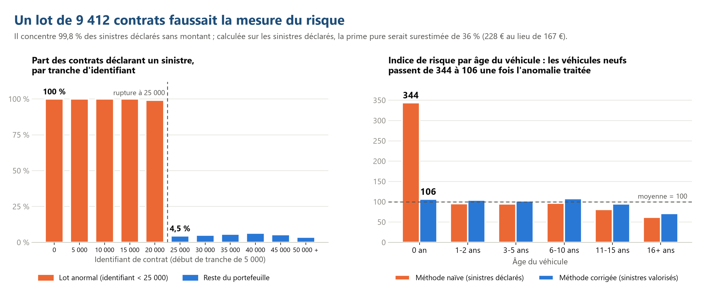
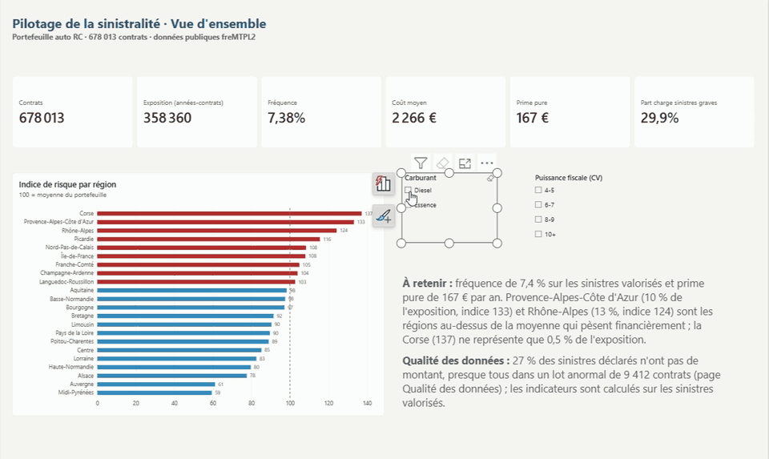
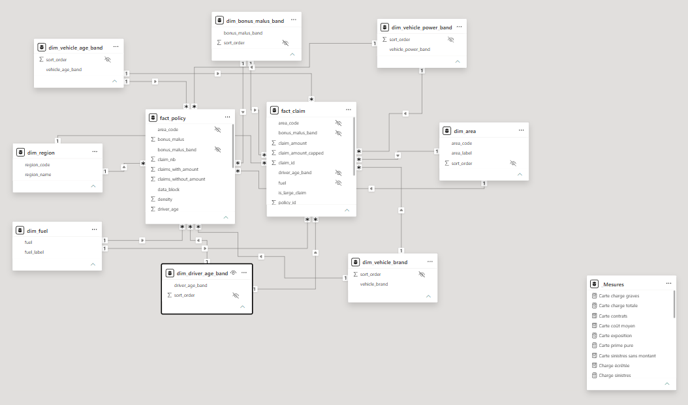
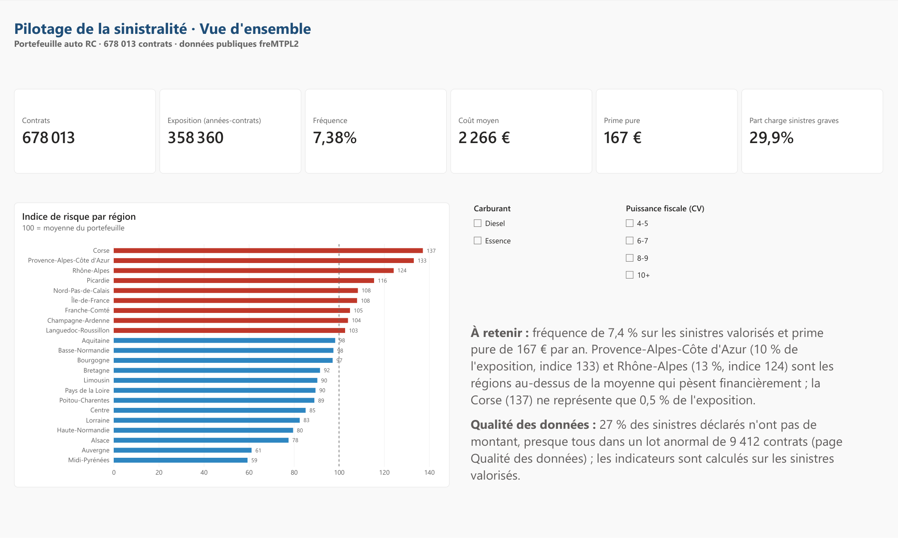
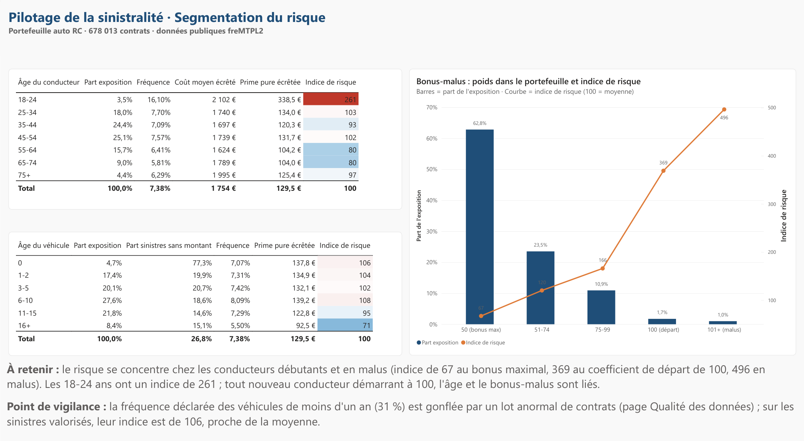
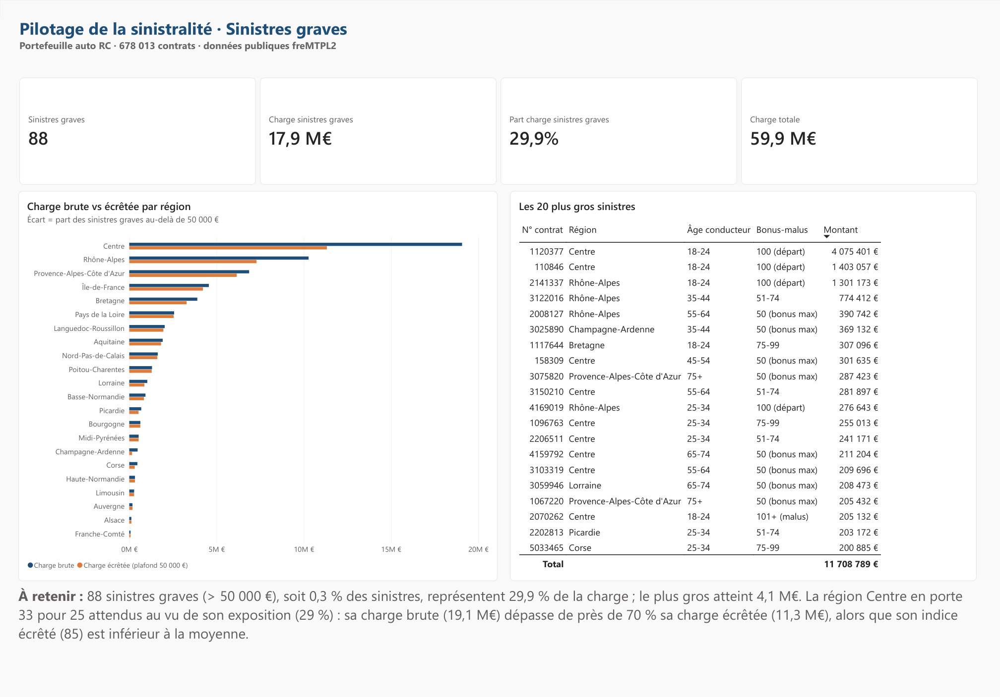
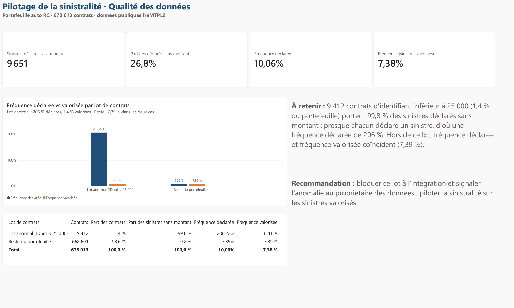
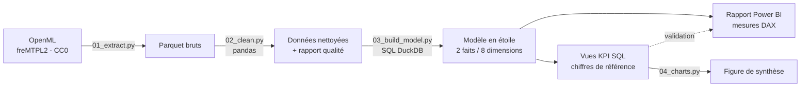

# Pilotage de la sinistralité d'un portefeuille auto

**Python (pandas) · SQL (DuckDB) · modélisation en étoile · Power BI · DAX · qualité des données · assurance IARD**

> **En bref.** Sur un portefeuille public de **678 013 contrats** d'assurance auto, j'ai construit la chaîne complète,
> de la donnée brute au tableau de bord, et découvert qu'**un lot de 9 412 contrats faussait la mesure du risque** :
> calculée sur les sinistres déclarés, la prime pure du portefeuille aurait été **surestimée de 36 %**, et les
> véhicules neufs présentés comme **3,4 fois plus risqués que la moyenne** alors qu'ils sont dans la moyenne.



**Le tableau de bord en action** : indices recalculés à la volée selon les filtres, et modèle sémantique en étoile
(2 tables de faits, 8 dimensions).





*English summary: end-to-end motor insurance claims analytics on a public French portfolio (678k policies): Python
data-quality pipeline, SQL star schema (DuckDB), Power BI dashboard with DAX validated against SQL. A root-cause
analysis showed that 1.4 % of policies held 99.8 % of the claims with no amount, which would have inflated the pure
premium by 36 % and made new vehicles look 3.4 times riskier than average when they are in fact average.*

## Questions métier

1. Les données de sinistres sont-elles assez fiables pour piloter le portefeuille ?
2. Quel est le coût attendu d'un contrat (prime pure) et quels segments s'écartent de la moyenne ?
3. Quel poids représentent les sinistres graves et où se concentrent-ils ?

## Ce que j'ai trouvé

1. **Une anomalie de données faussait la mesure du risque.** 27 % des sinistres déclarés n'ont pas de montant.
   Ils ne sont pas répartis au hasard : **99,8 % viennent de 9 412 contrats d'identifiant inférieur à 25 000**
   (1,4 % du portefeuille). La rupture est nette : 99,7 % des contrats de ce lot déclarent un sinistre, contre 4 à 6 %
   juste après l'identifiant 25 000. Hors de ce lot, fréquence déclarée et fréquence valorisée sont identiques
   (7,39 %). Le lot compte 41 % de véhicules neufs, d'où leur faux surrisque.
2. **Le risque se concentre chez les conducteurs débutants et en malus** : indice de 67 au bonus maximal (63 % de
   l'exposition), 369 au coefficient de départ (100) et 496 en malus. L'âge et le bonus-malus sont liés, car tout
   nouveau conducteur démarre à 100 (corrélation de −0,48) : les 18-24 ans ont un indice de 261, mais de 606 quand
   ils débutent (coefficient 100) contre 162 une fois entre 75 et 99. L'effet propre de chaque facteur reste à
   mesurer par un modèle multivarié.
3. **Le coût est très concentré** : 88 sinistres graves (> 50 000 €, 0,3 % des sinistres) portent 29,9 % de la
   charge, et le 1 % de sinistres les plus coûteux en porte 38 %.
4. **Deux régions pèsent financièrement au-dessus de la moyenne** : Provence-Alpes-Côte d'Azur (10 % de
   l'exposition, indice 133) et Rhône-Alpes (13 %, indice 124). La région Centre compte 33 sinistres graves pour
   25 attendus, mais son indice écrêté (85) reste sous la moyenne : quelques sinistres exceptionnels, pas un
   surrisque structurel. (La région Centre représente 29 % de l'exposition de ce jeu de données, une particularité
   de l'échantillon.)

## Recommandations

1. **Bloquer le lot anormal à l'intégration** et remonter l'anomalie au propriétaire des données, avec un contrôle
   automatique « fréquence déclarée vs fréquence valorisée » par lot de chargement.
2. **Piloter la sinistralité sur les sinistres valorisés** et suivre la fréquence déclarée comme indicateur de qualité.
3. **Mesurer l'effet propre de l'âge et de l'expérience** par un modèle multivarié avant toute décision sur les
   jeunes conducteurs : les deux facteurs sont liés et, l'échelle du bonus-malus étant fixée par la réglementation
   (clause type de réduction-majoration), c'est la tarification de base qui peut s'ajuster.
4. **Traiter les sinistres graves à part** (écrêtement, chargement spécifique) plutôt que de réagir à la charge
   brute d'une région.

## Utilisation du tableau de bord

| Utilisateurs | Décisions appuyées | Fréquence |
|---|---|---|
| Direction technique, actuariat | Suivi de la sinistralité, choix des segments à analyser en priorité | Mensuelle |
| Pilotage commercial | Zones géographiques à enjeu financier | Trimestrielle |
| Équipe données | Contrôle qualité de chaque chargement (règle ci-dessous) | À chaque chargement |

**Règle de qualité proposée** : pour chaque lot de chargement, comparer fréquence déclarée et fréquence valorisée ;
au-delà d'un point d'écart, le lot est bloqué et signalé au propriétaire des données avant publication des indicateurs.

## Livrables

| Livrable | Pour qui | Fichier |
|---|---|---|
| Tableau de bord Power BI (4 pages) | Direction technique, pilotage | [`.pbix`](powerbi/sinistralite_auto.pbix) · [projet `.pbip`](powerbi/sinistralite_auto.pbip) · [PDF](docs/rapport_sinistralite_auto.pdf) |
| Note de synthèse (1 page) | Direction | [PDF](docs/note_de_synthese.pdf) · [en ligne](docs/note_de_synthese.md) |
| Dictionnaire des indicateurs | Métier, BI, équipes data | [`docs/dictionnaire_indicateurs.md`](docs/dictionnaire_indicateurs.md) |
| Rapport de qualité des données et analyse de cause racine | Propriétaires des données | [`reports/data_quality_report.md`](reports/data_quality_report.md) |
| Chiffres de référence (validation des mesures DAX) | BI | [`reports/kpi_summary.md`](reports/kpi_summary.md) |
| Pipeline Python et SQL | Équipes data | [`src/`](src) · [`sql/`](sql) |

## Le tableau de bord

Chaque mesure DAX a été validée contre les chiffres de référence calculés en SQL ; la page de contrôle est masquée.

**Vue d'ensemble** : indicateurs du portefeuille et indice de risque par région.



**Segmentation du risque** : âge du conducteur, âge du véhicule et bonus-malus.



**Sinistres graves** : poids des sinistres de plus de 50 000 €, charge brute et écrêtée par région, les 20 plus
gros sinistres.



**Qualité des données** : fréquence déclarée et fréquence valorisée par lot de contrats.



## Démarche



| Étape | Outil | Ce qui est fait |
|---|---|---|
| Extraction | Python | Téléchargement des deux tables, contrôle de volumétrie bloquant |
| Nettoyage et qualité | pandas | Contrôles bloquants (doublons, valeurs manquantes, valeurs hors tranches), plafonnements usuels sur ce jeu (exposition à 1 an, 4 sinistres par contrat, d'après Noll, Salzmann et Wüthrich, 2018), rapprochement sinistres déclarés / valorisés contrat par contrat, analyse de cause racine |
| Modèle en étoile | SQL (DuckDB) | Deux tables de faits (contrats, sinistres) et huit dimensions, export Parquet pour Power BI |
| Indicateurs | SQL (DuckDB) | Vues avec CTE et fonctions de fenêtrage : indicateurs globaux, par segment, concentration de la charge, qualité par lot, méthode naïve vs corrigée, croisement âge × bonus-malus |
| Figure de synthèse | matplotlib | Figure du README, calculée à partir des vues SQL |
| Restitution | Power BI, DAX | Rapport de 4 pages, mesures validées contre le SQL |

**Méthode.** Fréquence = sinistres valorisés / exposition (années-contrats) ; coût moyen = charge / sinistres
valorisés ; prime pure = fréquence × coût moyen = charge / exposition ; indice de risque = prime pure écrêtée du
segment / prime pure écrêtée de la sélection × 100. Les sinistres sont écrêtés à 50 000 € pour comparer les segments.
Toutes les définitions sont dans le [dictionnaire des indicateurs](docs/dictionnaire_indicateurs.md).

**Modèle sémantique.** Les deux tables de faits partagent les huit dimensions par des relations un-à-plusieurs à
sens unique, sans relation entre elles : fréquence (contrats) et coût (sinistres) se combinent dans un même visuel
sans filtrage bidirectionnel.

```dax
Fréquence = DIVIDE ( [Sinistres avec montant], [Exposition] )
Fréquence déclarée = DIVIDE ( [Sinistres déclarés], [Exposition] )
Prime pure écrêtée = [Fréquence] * [Coût moyen écrêté]
Prime pure écrêtée portefeuille = CALCULATE ( [Prime pure écrêtée], ALLSELECTED () )
Indice de risque = DIVIDE ( [Prime pure écrêtée], [Prime pure écrêtée portefeuille] ) * 100
```

Le modèle complet (tables, relations, 30 mesures) est versionné en texte au format TMDL dans
[`powerbi/sinistralite_auto.SemanticModel/definition`](powerbi/sinistralite_auto.SemanticModel/definition).

## Limites et prochaines étapes

- Les indices sont univariés et les facteurs sont liés (âge et bonus-malus : corrélation de −0,48). Étape suivante :
  un GLM de Poisson pour la fréquence, avec l'exposition en offset, et un GLM Gamma pour le coût.
- Le jeu ne contient pas les primes encaissées : pas de ratio sinistres / primes. La prime pure mesure un coût
  technique attendu, pas une rentabilité.
- Les segments à faible exposition demanderaient une approche de crédibilité (Corse : 0,5 % de l'exposition).
- L'écrêtement retire l'excédent des sinistres graves au lieu de le répartir : la prime pure écrêtée sert à
  comparer les segments, pas à tarifer.
- La cause exacte de l'anomalie (chargement partiel de la table des sinistres pour les premiers contrats ?) reste à
  confirmer avec le propriétaire des données.
- Version 2 envisagée sur Microsoft Fabric : Lakehouse, notebook Spark, modèle sémantique Direct Lake.

## Lancer le projet

```bash
pip install -r requirements.txt
python run_pipeline.py
```

Les données sont téléchargées automatiquement depuis OpenML et le modèle est exporté en Parquet dans `data/powerbi/`.
Pour consulter le rapport : ouvrir `powerbi/sinistralite_auto.pbix` (données incluses). Pour l'actualiser, ou pour
partir du projet `powerbi/sinistralite_auto.pbip`, indiquer dans le paramètre `DossierDonnees` (*Transformer les
données > Gérer les paramètres*) le chemin complet du dossier `data\powerbi\`, puis *Actualiser*.

## Données

Jeu de données **freMTPL2** ([OpenML 41214](https://www.openml.org/d/41214) et
[41215](https://www.openml.org/d/41215), licence CC0) : portefeuille réel d'un assureur français en responsabilité
civile automobile, diffusé dans le package R *CASdatasets* (C. Dutang et A. Charpentier), compagnon de l'ouvrage
*Computational Actuarial Science with R* (A. Charpentier, dir., CRC Press, 2014).

---

**Chaimaa FAQUIR**, Data Analyst, certifiée Microsoft PL-300 et DP-600 ·
[LinkedIn](https://www.linkedin.com/in/chaimaa-faquir)
